<!-- Numbers in this file live only inside "generated" blocks, written from committed results
JSON by `python scripts/make_tables.py` (CI fails if a block is stale or hand-edited). Prose
outside the blocks carries no metric value (CLAUDE.md rule 3, D-067). -->

# event-maritime-flow

**How much does a network for event-camera optical flow lose when it is trained on simulated
(v2e) events instead of real ones — measured with everything else held fixed — and what can
simulated events from maritime video show at all?**

[](https://github.com/kbasak01/event-maritime-flow/actions/workflows/ci.yml)
[](LICENSE)
[](docs/RELEASE.md)


<p align="center">
  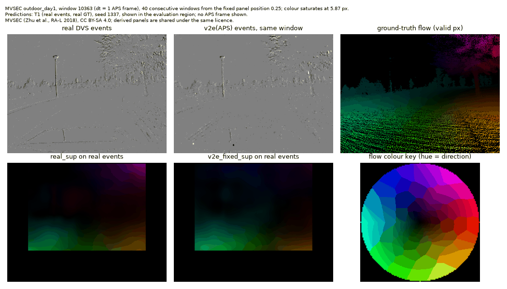
</p>
<p align="center"><sub>
MVSEC <code>outdoor_day1</code>, consecutive test windows from a window position fixed before any
prediction was viewed. Top: real DVS events, v2e events simulated from the APS frames of the same
sensor, ground-truth flow. Bottom: flow predicted <b>on the real events</b> by the same network
trained on real events (<code>real_sup</code>) and on v2e events (<code>v2e_fixed_sup</code>) (T1).
No APS frame is shown. Derived from MVSEC (Zhu et al., RA-L 2018), CC BY-SA 4.0; this animation
is shared under the same licence.
</sub></p>

**Jump to:** [Key findings](#key-findings) · [Headline: the simulator gap](#headline-the-matched-content-simulator-gap) ·
[Evidence tiers](#evidence-tiers) · [What synthetic events can and cannot show](#what-synthetic-events-can-and-cannot-show) ·
[Gallery](#gallery) · [Maritime (T3)](#maritime-track-t3--synthetic-events-no-ground-truth) ·
[Deployment](#deployment-onnx-parity-and-timing) · [Reproduce](#reproduce) ·
[Limitations](#limitations) · [Release](#release-assets) · [Licences](#licences-and-attribution) ·
[Citations](#citations)

## Key findings

MVSEC numbers below use the evaluation protocol of `configs/eval_mvsec.yaml` (quoted under
[Reproduce](#reproduce)): windows of dt = 1 or 4 APS frame intervals, sparse mask (pixels with
events and valid ground truth), fixed evaluation regions, mean over windows of the per-window
mean; EPE in px over the window, never compared across dt.

<!-- BEGIN generated:key-findings -->
- **Matched-content simulator gap, outdoor_day1 (T1: real MVSEC test events, real ground-truth flow; dt = 1 APS frame; 3 seeds per arm).** The same network trained on calibrated v2e events vs on the real events of the same frames gives EPE(`v2e_fixed_sup`) − EPE(`real_sup`) = 0.055 px [95 % CI 0.024, 0.078] (> 0: v2e training is worse); the gap is positive in every one of the 3 × 3 single-seed pairings (range [0.004, 0.128]). At dt = 4 it is 0.161 px [95 % CI 0.064, 0.246], positive in every one of the 3 × 3 single-seed pairings (range [0.054, 0.230]). On this sequence at dt = 1, `real_sup` is clearly below the zero-flow EPE (CIs do not overlap).
- **No measurable closure from contrast-threshold randomisation on outdoor_day1 (T1).** With 3 seeds per arm, `v2e_rand_sup` − `real_sup` = 0.070 px [95 % CI 0.024, 0.119] at dt = 1, positive in every one of the 3 × 3 single-seed pairings (range [0.052, 0.100]); closure = -0.276 [95 % CI -1.373, 0.343] at dt = 1 (its sign changes across the 3 × 3 × 3 single-seed pairings (range [-12.914, 0.395])) and 0.232 [95 % CI -0.280, 0.572] at dt = 4 (its sign changes across the 3 × 3 × 3 single-seed pairings (range [-0.253, 0.597])); closure 1 = gap fully closed, 0 = no change.
- **Pooled over the four MVSEC test sequences (T1, dt = 1)** the fixed-CT gap is -0.019 px [95 % CI -0.039, -0.0004] and its sign changes across the 3 × 3 single-seed pairings (range [-0.115, 0.081]): no stable sign. On the indoor sequences the supervised arms sit at or near the zero-flow floor (D-046), so pooled gaps mostly compare models near that floor, not a v2e advantage.
- **Self-supervised arms (T1, one seed each).** `v2e_selfsup` − `real_selfsup` = -0.160 px [95 % CI -0.197, -0.128] pooled at dt = 1 (CI excludes 0) and 0.105 px [95 % CI 0.057, 0.136] on outdoor_day1 at dt = 1 (CI excludes 0); single-seed results, not seed-tested, and the pooled value carries the same indoor zero-flow-floor caveat.
- **Scored on v2e(APS) test events instead (T2, outdoor_day1, dt = 1, 3 seeds per arm)**, the same fixed-CT gap is -0.114 px [95 % CI -0.158, -0.079], negative in every one of the 3 × 3 single-seed pairings (range [-0.159, -0.066]): on simulated test events the v2e-trained arm has the lower EPE, the opposite sign to T1, so a sim-only benchmark would hide the T1 gap.
- **Sea clutter in synthetic v2e(LaRS) events (T3b, 40 `lars_eval` keyframe windows, calibrated CT ×1, LaRS frame rate assumed 30 fps).** Water covers 0.496 of the pixels but receives 0.276 of the events (enrichment 0.555 [95 % CI 0.341, 0.993]). This describes v2e on these frames, not a real sensor; 38 of the 40 clips are labelled `moderate` waves.
- **Deployment (fp32 only, D-064).** The fp32 ONNX graph (ONNX Runtime CUDA EP) of the `real_sup` seed-1337 checkpoint (lowest `mvsec_tune` EPE, D-063) matches PyTorch within 7.32e-05 px max |Δflow| on 200 real `mvsec_test` windows (T1). End-to-end events → flow at 346×260 with 10⁵ events per window: p50 12.352 ms (ORT CUDA fp32, composed) and 11.842 ms (PyTorch eager fp32, measured) on an RTX A4000 that stands in for an embedded target (same checkpoint, `real_sup_voxel5_s1337`). Hardware timing of the network, not event-sensor latency; the fp16 graphs failed the parity tolerance.
<!-- END generated:key-findings -->

## Headline: the matched-content simulator gap

<p align="center">
  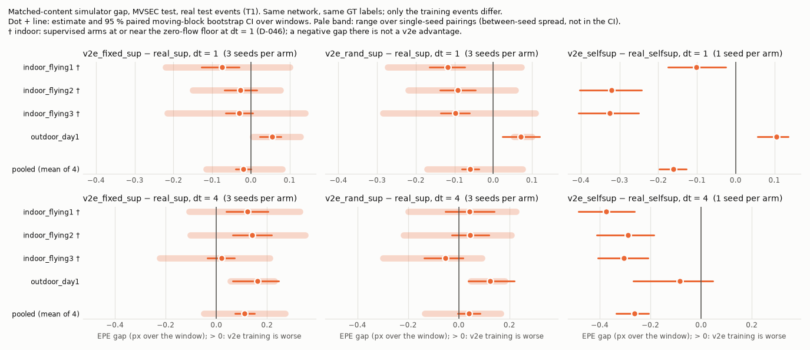
</p>
<p align="center"><sub>
T1 (real MVSEC test events, real ground-truth flow). Each panel compares the identical network
trained on v2e events against the one trained on the real events of the same recording, on the
same windows. Numbers: Table B-T1 below and in <a href="results/TABLES.md">results/TABLES.md</a>.
Metric plot derived from MVSEC (CC BY-SA 4.0).
</sub></p>

**Table B-T1 — simulator gap and closure, real test events (T1)** (MVSEC protocol: see
[Reproduce](#reproduce))

<!-- BEGIN generated:table-b-notes -->
gap = EPE(v2e arm) − EPE(real arm) on the same windows (> 0: the v2e-trained arm is worse). closure = 1 − gap(v2e_rand_sup) / gap(v2e_fixed_sup). Supervised arms: 3-seed means; self-supervised arms: one seed each. n = windows scored in every series of the comparison.

Reading notes:  
- `r` = range of the statistic over single-seed pairings (supervised gaps: 3 × 3 seeds; closure: 3 × 3 × 3; T2 − T1: same model, 3 seeds); the CI covers windows only. A CI that excludes 0 while `r` spans 0 means the sign is not stable across training seeds.  
- Indoor dt = 1: on indoor_flying1 no supervised M1 arm has a lower EPE than zero flow, and on indoor_flying3 real_sup does not either (Table A-T1; D-046); negative gaps on these sequences compare models at or near the zero-flow floor and are not evidence that v2e training is better.  
- closure is a ratio: where gap(v2e_fixed_sup) is small its CI is wide; values above 1 (randomisation overshoots the real arm) are within that uncertainty, not a finding.  
<!-- END generated:table-b-notes -->

<!-- BEGIN generated:table-b-t1 -->
**EPE gap, dt = 1**

| tier | comparison | indoor_flying1 (n=2193) | indoor_flying2 (n=2652) | indoor_flying3 (n=2939) | outdoor_day1 (n=797) | pooled (mean of 4) |
|---|---|---|---|---|---|---|
| T1 | gap v2e_fixed_sup − real_sup | -0.075 [-0.127, -0.030] r [-0.221, 0.100] | -0.027 [-0.069, 0.015] r [-0.150, 0.076] | -0.030 [-0.066, 0.005] r [-0.216, 0.140] | 0.055 [0.024, 0.078] r [0.004, 0.128] | -0.019 [-0.039, -0.0004] r [-0.115, 0.081] |
| T1 | gap v2e_rand_sup − real_sup | -0.117 [-0.165, -0.074] r [-0.273, 0.072] | -0.092 [-0.137, -0.046] r [-0.220, 0.057] | -0.098 [-0.136, -0.062] r [-0.285, 0.108] | 0.070 [0.024, 0.119] r [0.052, 0.100] | -0.059 [-0.080, -0.037] r [-0.171, 0.075] |
| T1 | closure (CT randomisation) | — (1) | — (1) | — (1) | -0.276 [-1.373, 0.343] r [-12.914, 0.395] | — (1) |
| T1 | gap v2e_selfsup − real_selfsup | -0.101 [-0.174, -0.025] | -0.320 [-0.402, -0.243] | -0.325 [-0.407, -0.250] | 0.105 [0.057, 0.136] | -0.160 [-0.197, -0.128] |

**EPE gap, dt = 4**

| tier | comparison | indoor_flying1 (n=2190) | indoor_flying2 (n=2649) | indoor_flying3 (n=2936) | outdoor_day1 (n=794) | pooled (mean of 4) |
|---|---|---|---|---|---|---|
| T1 | gap v2e_fixed_sup − real_sup | 0.122 [0.040, 0.205] r [-0.107, 0.329] | 0.140 [0.065, 0.217] r [-0.103, 0.349] | 0.020 [-0.036, 0.072] r [-0.225, 0.211] | 0.161 [0.064, 0.246] r [0.054, 0.230] | 0.111 [0.074, 0.150] r [-0.049, 0.271] |
| T1 | gap v2e_rand_sup − real_sup | 0.042 [-0.053, 0.139] r [-0.199, 0.225] | 0.045 [-0.027, 0.120] r [-0.217, 0.208] | -0.053 [-0.138, 0.018] r [-0.300, 0.091] | 0.124 [0.037, 0.220] r [0.047, 0.182] | 0.039 [-0.005, 0.083] r [-0.133, 0.166] |
| T1 | closure (CT randomisation) | 0.655 [0.260, 2.037] r [-0.574, 3.919] (2) | 0.682 [0.393, 1.387] r [-0.073, 5.286] (2) | — (1) | 0.232 [-0.280, 0.572] r [-0.253, 0.597] | 0.645 [0.389, 1.057] r [-0.201, 2.704] (2) |
| T1 | gap v2e_selfsup − real_selfsup | -0.375 [-0.485, -0.263] | -0.288 [-0.412, -0.187] | -0.305 [-0.408, -0.209] | -0.084 [-0.269, 0.045] | -0.263 [-0.335, -0.208] |

(1) undefined: gap(v2e_fixed_sup) CI includes 0 or lies below it  
(2) seed-unstable (D-053): gap(v2e_fixed_sup) ≤ 0 for some single-seed pairings (`n_fixed_gap_pairings_nonpositive` in paired.json); `r` covers the pairings with a positive gap only  
<!-- END generated:table-b-t1 -->

<details>
<summary><b>How the statistics are computed</b></summary>

<!-- BEGIN generated:stats-note -->
**Statistics.** Mean over evaluation windows of the per-window mean (configs/eval_mvsec.yaml). [lo, hi] = 95 % moving-block bootstrap CI over windows (block 1.0 s of windows, 1000 resamples, seed 0). 3-seed arms: seed mean, CI of the seed-mean per-window series, `r` = range of the per-seed means. Gaps, closure and T2 − T1: paired bootstrap on the same windows; pooled = mean of the four sequence means, each sequence resampled independently. **CIs resample windows only** (each arm's seed mean held fixed); between-seed variation is shown by `r` (Table A: range of the per-seed means; Table B: range over single-seed combinations, D-053) and is not in the CI. EPE in px over the window (dt = k APS frame intervals; never compared across dt).
<!-- END generated:stats-note -->

</details>

## Evidence tiers

Every flow metric in this repository carries one of these tags (plan §0(2)); latency rows are
hardware timing and carry none. T3 numbers never share a table section with T1/T2 numbers, and
"EPE" is reserved for T1/T2.

| Tier | Events | Flow reference | What it can support | Datasets |
|---|---|---|---|---|
| **T1** | real | real ground truth (depth + pose motion field, or LiDAR) | accuracy claims | MVSEC, DSEC-Flow |
| **T2** | v2e, from frames of the *same sensor* | the same real ground truth as T1 | simulator-gap claims | MVSEC (APS → v2e) |
| **T3a** | v2e, from maritime video | RAFT on the source frames ("teacher") | agreement with a frame-based teacher (**teacher-EPE**), never accuracy | SMD, LaRS |
| **T3b** | v2e, from maritime video | none — FWL / RSAT self-consistency | sharpness of motion compensation, never accuracy | SMD, LaRS |

## What synthetic events can and cannot show

> [!IMPORTANT]
> **v2e cannot add information that the source video does not contain.** It turns frames into
> events by modelling log-intensity change, thresholds and noise, and fills the time between
> frames by interpolation. Its events therefore inherit the source camera's dynamic range, its
> motion blur, its compression artefacts and its frame-rate limits.
>
> - **Can show:** the *pipeline* (data handling, training, evaluation, deployment) and the
>   *motion content* of a scene; the size of the simulator gap when content, viewpoint and labels
>   are held fixed (T2 vs T1 on MVSEC); how v2e's event budget splits between water, sky and
>   obstacles as its contrast threshold changes (T3b, synthetic).
> - **Cannot show:** behaviour under sun glare or high dynamic range, or any latency advantage of
>   an event sensor. **No result in this repository is a claim about either.** The latency table
>   below times the network on a GPU; it says nothing about sensor latency.
> - **Known artefact:** v2e spreads several events per pixel between interpolated frames in a
>   fixed timestamp pattern ("pyramids", D-025) that real sensors do not have; a network can learn
>   it.
> - **Maritime numbers have no ground truth.** T3a measures agreement with a frame-based RAFT
>   teacher that is itself unreliable on water and glint; T3b measures self-consistency.

## The matched-content experiment

MVSEC's DAVIS 346B cameras record APS grayscale frames and DVS events through the same lens on the
same pixel grid, and MVSEC ships dense ground-truth flow for the left camera. Running v2e on the
APS frames gives synthetic events in exactly the geometry of the real events, so **the same
ground truth supervises both**. Train the identical network on each, evaluate both on real
events: the difference is the simulator gap, isolated from content, viewpoint and label noise.
The v2e contrast threshold is calibrated on a tune slice of the training sequence only
(`mvsec_tune`), and a second arm randomises it at train time (Stoffregen et al., ECCV 2020).

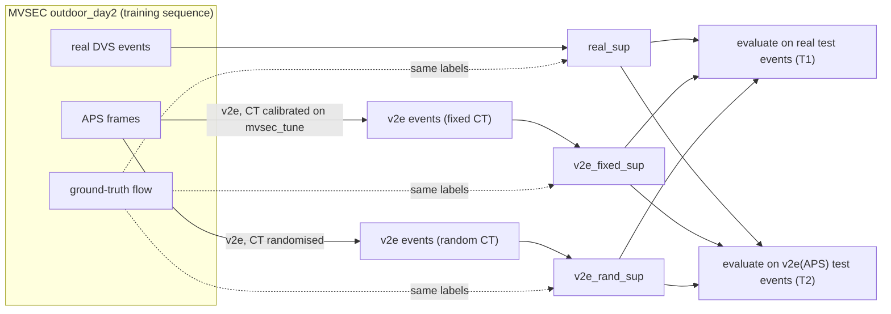

The self-supervised arms (`real_selfsup`, `v2e_selfsup`) train the same network with a
contrast-maximisation loss instead of labels. Baselines: zero flow (M0a), contrast maximisation
(M0b), and the released E-RAFT checkpoints as external references (R1).

## Gallery

### Flow on fixed MVSEC windows (T1)

<p align="center">
  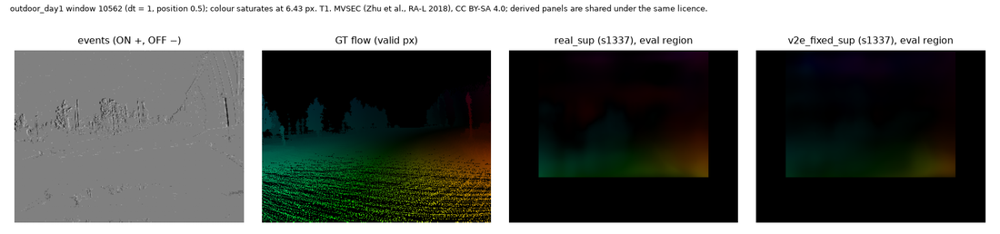
</p>

<details>
<summary><b>All six fixed windows</b> (positions set in <code>configs/evflow.yaml</code> before any prediction was viewed)</summary>

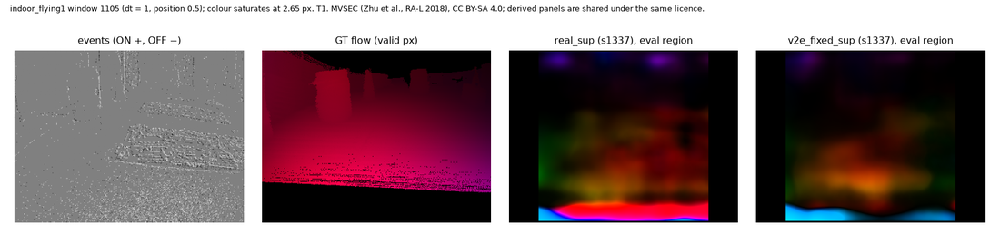
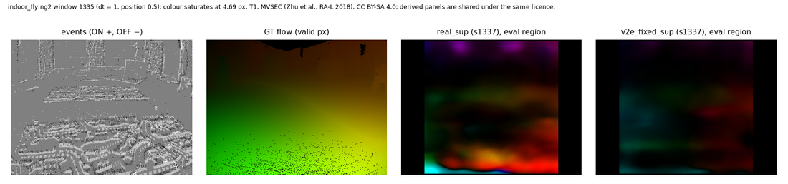
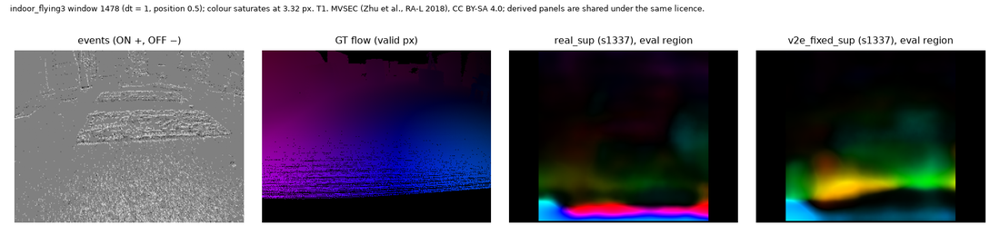
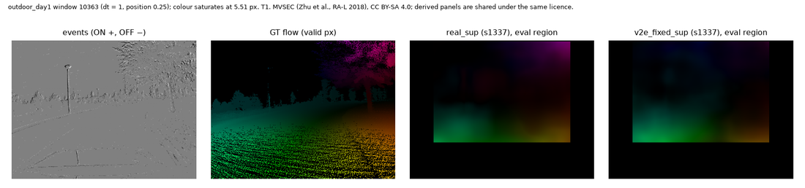

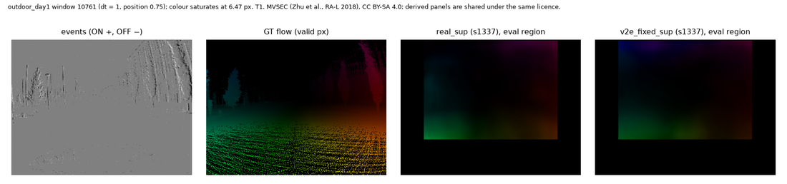

</details>

<sub>Hue = direction, brightness = magnitude, saturated per window at the 99th percentile of the
ground-truth magnitude; predictions shown inside the evaluation region. Derived from MVSEC (Zhu et
al., RA-L 2018), CC BY-SA 4.0; shared under the same licence.</sub>

### Real vs simulated event statistics (T2, reported only)

<p align="center">
  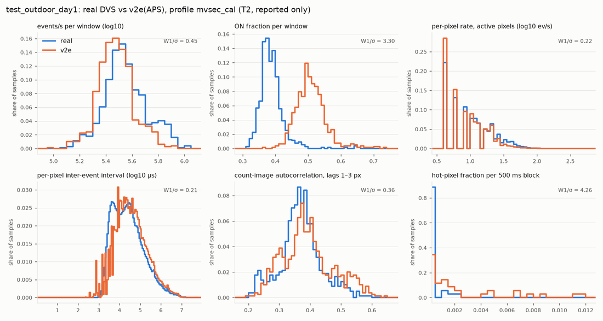
</p>
<sub>Six event statistics of the real DAVIS events and of v2e events simulated from the APS frames
of the same test sequence, calibrated profile (D-033, D-035). Test-sequence statistics are
reported, never used for any choice. The per-statistic distances for every sequence are in
<code>results/fidelity/summary.json</code> and discussed in <a href="docs/LIMITATIONS.md">docs/LIMITATIONS.md</a>.
Derived from MVSEC, CC BY-SA 4.0.</sub>

### EPE per sequence, real test events (T1)

<p align="center">
  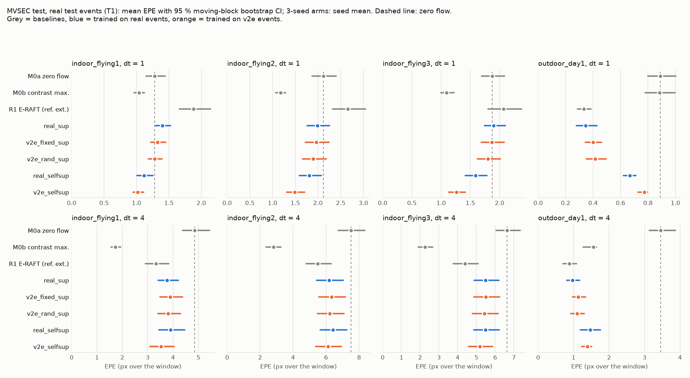
</p>
<sub>T1. Metric plot derived from MVSEC (CC BY-SA 4.0).</sub>

<details>
<summary><b>Table A-T1 — EPE per arm and sequence (T1)</b></summary>

<!-- BEGIN generated:table-a-t1 -->
**EPE (px), dt = 1**

| tier | arm | model | rep. | seeds | indoor_flying1 (n=2193) | indoor_flying2 (n=2652) | indoor_flying3 (n=2939) | outdoor_day1 (n=797) |
|---|---|---|---|---|---|---|---|---|
| T1 | zero_flow | M0a | – | – | 1.279 [1.150, 1.442] | 2.119 [1.872, 2.400] | 1.872 [1.689, 2.084] | 0.890 [0.800, 1.004] |
| T1 | cm_baseline | M0b | – | – | 1.037 [0.965, 1.120] | 1.174 [1.071, 1.287] | 1.093 [0.997, 1.219] | 0.885 [0.779, 0.999] |
| T1 | eraft_mvsec20 `reference_external` | R1 | – | – | 1.879 [1.663, 2.141] | 2.656 [2.324, 3.044] | 2.067 [1.803, 2.373] | 0.334 [0.287, 0.384] |
| T1 | real_sup | M1 | voxel5 | 1337/2026/7 | 1.399 [1.294, 1.522] r [1.277, 1.508] | 1.987 [1.759, 2.254] r [1.902, 2.079] | 1.896 [1.738, 2.097] r [1.770, 2.029] | 0.346 [0.279, 0.427] r [0.320, 0.361] |
| T1 | v2e_fixed_sup | M1 | voxel5 | 1337/2026/7 | 1.324 [1.219, 1.447] r [1.288, 1.378] | 1.960 [1.719, 2.248] r [1.928, 1.979] | 1.866 [1.687, 2.081] r [1.813, 1.910] | 0.401 [0.344, 0.462] r [0.365, 0.448] |
| T1 | v2e_rand_sup | M1 | voxel5 | 1337/2026/7 | 1.282 [1.181, 1.393] r [1.235, 1.350] | 1.895 [1.663, 2.181] r [1.859, 1.959] | 1.799 [1.621, 2.011] r [1.744, 1.879] | 0.416 [0.350, 0.495] r [0.414, 0.420] |
| T1 | real_selfsup | M1 | voxel5 | 1337 | 1.118 [1.009, 1.250] | 1.810 [1.592, 2.071] | 1.588 [1.415, 1.784] | 0.668 [0.622, 0.713] |
| T1 | v2e_selfsup | M1 | voxel5 | 1337 | 1.017 [0.947, 1.108] | 1.489 [1.308, 1.709] | 1.263 [1.132, 1.415] | 0.773 [0.726, 0.797] |

**EPE (px), dt = 4**

| tier | arm | model | rep. | seeds | indoor_flying1 (n=2190) | indoor_flying2 (n=2649) | indoor_flying3 (n=2936) | outdoor_day1 (n=794) |
|---|---|---|---|---|---|---|---|---|
| T1 | zero_flow | M0a | – | – | 4.851 [4.377, 5.437] | 7.513 [6.740, 8.358] | 6.635 [6.040, 7.340] | 3.458 [3.135, 3.868] |
| T1 | cm_baseline | M0b | – | – | 1.722 [1.550, 1.934] | 2.802 [2.364, 3.258] | 2.250 [1.897, 2.663] | 1.554 [1.269, 1.646] |
| T1 | eraft_mvsec20 `reference_external` | R1 | – | – | 3.332 [2.917, 3.826] | 5.502 [4.782, 6.317] | 4.382 [3.761, 5.078] | 0.879 [0.704, 1.082] |
| T1 | real_sup | M1 | voxel5 | 1337/2026/7 | 3.760 [3.418, 4.203] r [3.663, 3.924] | 6.180 [5.435, 7.030] r [6.069, 6.367] | 5.473 [4.871, 6.197] r [5.390, 5.635] | 0.971 [0.813, 1.170] r [0.923, 1.036] |
| T1 | v2e_fixed_sup | M1 | voxel5 | 1337/2026/7 | 3.882 [3.479, 4.374] r [3.817, 3.992] | 6.321 [5.569, 7.174] r [6.265, 6.418] | 5.493 [4.865, 6.232] r [5.410, 5.601] | 1.132 [0.973, 1.340] r [1.091, 1.153] |
| T1 | v2e_rand_sup | M1 | voxel5 | 1337/2026/7 | 3.802 [3.404, 4.299] r [3.725, 3.888] | 6.225 [5.468, 7.090] r [6.150, 6.276] | 5.420 [4.786, 6.158] r [5.336, 5.482] | 1.094 [0.921, 1.302] r [1.083, 1.105] |
| T1 | real_selfsup | M1 | voxel5 | 1337 | 3.896 [3.438, 4.465] | 6.413 [5.645, 7.245] | 5.485 [4.862, 6.213] | 1.471 [1.191, 1.762] |
| T1 | v2e_selfsup | M1 | voxel5 | 1337 | 3.521 [3.093, 4.043] | 6.125 [5.374, 6.927] | 5.180 [4.581, 5.857] | 1.387 [1.225, 1.507] |

Notes:  
- `zero_flow` (M0a) is the reference every arm is read against; `real_sup` is above it on indoor_flying1 dt = 1 (D-046).  
- R1 = E-RAFT 20 Hz MVSEC checkpoint, `reference_external`, trained on outdoor_day2; worse than zero flow on indoor dt = 1 (D-042).  
- All M1 arms train and select identically on the same outdoor_day2 windows (D-043); only the training events differ.  
<!-- END generated:table-a-t1 -->

</details>

### The same comparison on simulated test events (T2)

<p align="center">
  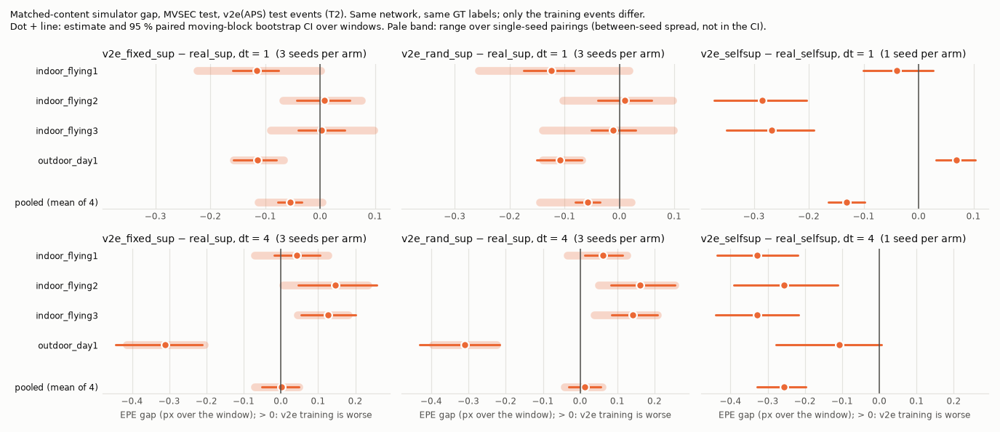
</p>
<p align="center">
  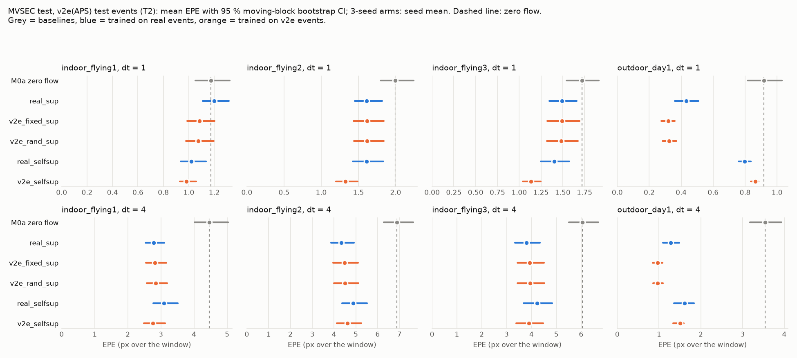
</p>
<sub>T2: same windows and ground truth, but the test events are v2e simulations from the APS
frames. Metric plots derived from MVSEC (CC BY-SA 4.0).</sub>

<details>
<summary><b>Table B-T2 — gap, closure and T2 − T1 per model (T2)</b></summary>

<!-- BEGIN generated:table-b-t2 -->
**EPE gap, dt = 1**

| tier | comparison | indoor_flying1 (n=2193) | indoor_flying2 (n=2507) | indoor_flying3 (n=2886) | outdoor_day1 (n=797) | pooled (mean of 4) |
|---|---|---|---|---|---|---|
| T2 | gap v2e_fixed_sup − real_sup | -0.115 [-0.159, -0.076] r [-0.224, 0.0004] | 0.007 [-0.043, 0.054] r [-0.067, 0.075] | 0.002 [-0.040, 0.045] r [-0.091, 0.098] | -0.114 [-0.158, -0.079] r [-0.159, -0.066] | -0.055 [-0.077, -0.034] r [-0.113, 0.004] |
| T2 | gap v2e_rand_sup − real_sup | -0.124 [-0.174, -0.083] r [-0.256, 0.018] | 0.009 [-0.039, 0.058] r [-0.103, 0.097] | -0.011 [-0.051, 0.030] r [-0.140, 0.099] | -0.108 [-0.151, -0.069] r [-0.140, -0.068] | -0.058 [-0.080, -0.036] r [-0.145, 0.021] |
| T2 | closure (CT randomisation) | — (1) | — (1) | — (1) | — (1) | — (1) |
| T2 | gap v2e_selfsup − real_selfsup | -0.040 [-0.101, 0.027] | -0.286 [-0.373, -0.205] | -0.268 [-0.350, -0.190] | 0.068 [0.031, 0.103] | -0.131 [-0.164, -0.098] |

**EPE gap, dt = 4**

| tier | comparison | indoor_flying1 (n=2190) | indoor_flying2 (n=2550) | indoor_flying3 (n=2907) | outdoor_day1 (n=794) | pooled (mean of 4) |
|---|---|---|---|---|---|---|
| T2 | gap v2e_fixed_sup − real_sup | 0.042 [-0.019, 0.106] r [-0.071, 0.126] | 0.146 [0.047, 0.257] r [0.006, 0.233] | 0.127 [0.055, 0.201] r [0.044, 0.182] | -0.312 [-0.445, -0.212] r [-0.415, -0.206] | 0.001 [-0.051, 0.048] r [-0.071, 0.048] |
| T2 | gap v2e_rand_sup − real_sup | 0.061 [0.013, 0.114] r [-0.035, 0.126] | 0.160 [0.082, 0.254] r [0.049, 0.254] | 0.141 [0.084, 0.207] r [0.038, 0.207] | -0.311 [-0.432, -0.215] r [-0.396, -0.225] | 0.013 [-0.031, 0.055] r [-0.042, 0.059] |
| T2 | closure (CT randomisation) | — (1) | -0.099 [-0.748, 0.118] r [-20.946, 0.515] | -0.105 [-0.574, 0.074] r [-1.172, 0.454] | — (1) | — (1) |
| T2 | gap v2e_selfsup − real_selfsup | -0.329 [-0.437, -0.219] | -0.257 [-0.391, -0.111] | -0.329 [-0.441, -0.216] | -0.107 [-0.278, 0.006] | -0.256 [-0.328, -0.197] |

**T2 − T1: the same model on v2e vs real test events** (EPE difference, same windows and GT, each stream's own sparse mask; < 0: lower EPE on v2e events). These rows combine a T2 series with the same model's T1 series; they are tagged T2 because they measure the simulator (D-051(c)).

*dt = 1*

| tier | comparison | indoor_flying1 (n=2193) | indoor_flying2 (n=2507) | indoor_flying3 (n=2886) | outdoor_day1 (n=797) | pooled (mean of 4) |
|---|---|---|---|---|---|---|
| T2 | real_sup | -0.200 [-0.260, -0.136] r [-0.231, -0.149] | -0.483 [-0.605, -0.379] r [-0.535, -0.417] | -0.438 [-0.529, -0.365] r [-0.523, -0.350] | 0.086 [0.065, 0.104] r [0.077, 0.101] | -0.259 [-0.300, -0.224] r [-0.303, -0.204] |
| T2 | v2e_fixed_sup | -0.241 [-0.292, -0.178] r [-0.248, -0.234] | -0.447 [-0.573, -0.349] r [-0.475, -0.423] | -0.405 [-0.494, -0.332] r [-0.429, -0.393] | -0.083 [-0.106, -0.065] r [-0.123, -0.059] | -0.294 [-0.337, -0.261] r [-0.301, -0.283] |
| T2 | v2e_rand_sup | -0.208 [-0.260, -0.150] r [-0.240, -0.181] | -0.376 [-0.502, -0.275] r [-0.413, -0.333] | -0.349 [-0.439, -0.278] r [-0.402, -0.284] | -0.092 [-0.129, -0.064] r [-0.097, -0.088] | -0.256 [-0.301, -0.221] r [-0.288, -0.221] |
| T2 | real_selfsup | -0.098 [-0.151, -0.042] | -0.269 [-0.370, -0.181] | -0.204 [-0.275, -0.140] | 0.128 [0.094, 0.166] | -0.111 [-0.147, -0.078] |
| T2 | v2e_selfsup | -0.037 [-0.092, 0.020] | -0.238 [-0.359, -0.137] | -0.148 [-0.231, -0.069] | 0.092 [0.074, 0.120] | -0.083 [-0.120, -0.044] |
| T2 | zero_flow | -0.105 [-0.130, -0.079] | -0.236 [-0.308, -0.170] | -0.185 [-0.236, -0.137] | 0.027 [0.009, 0.037] | -0.125 [-0.150, -0.104] |

*dt = 4*

| tier | comparison | indoor_flying1 (n=2190) | indoor_flying2 (n=2550) | indoor_flying3 (n=2907) | outdoor_day1 (n=794) | pooled (mean of 4) |
|---|---|---|---|---|---|---|
| T2 | real_sup | -0.981 [-1.144, -0.837] r [-1.056, -0.918] | -2.058 [-2.515, -1.677] r [-2.166, -1.981] | -1.718 [-2.067, -1.420] r [-1.808, -1.672] | 0.307 [0.244, 0.365] r [0.275, 0.331] | -1.113 [-1.260, -0.995] r [-1.189, -1.061] |
| T2 | v2e_fixed_sup | -1.061 [-1.263, -0.869] r [-1.142, -1.020] | -2.058 [-2.489, -1.717] r [-2.146, -1.959] | -1.611 [-1.945, -1.331] r [-1.703, -1.537] | -0.167 [-0.288, -0.085] r [-0.183, -0.155] | -1.224 [-1.360, -1.112] r [-1.288, -1.175] |
| T2 | v2e_rand_sup | -0.962 [-1.170, -0.766] r [-1.039, -0.887] | -1.944 [-2.364, -1.602] r [-2.023, -1.819] | -1.524 [-1.873, -1.231] r [-1.587, -1.410] | -0.128 [-0.237, -0.052] r [-0.140, -0.110] | -1.139 [-1.277, -1.019] r [-1.197, -1.062] |
| T2 | real_selfsup | -0.806 [-1.055, -0.567] | -1.748 [-2.189, -1.361] | -1.311 [-1.594, -1.040] | 0.145 [0.044, 0.214] | -0.930 [-1.066, -0.804] |
| T2 | v2e_selfsup | -0.760 [-0.995, -0.533] | -1.719 [-2.180, -1.302] | -1.335 [-1.663, -1.039] | 0.122 [0.037, 0.176] | -0.923 [-1.078, -0.790] |
| T2 | zero_flow | -0.389 [-0.472, -0.299] | -0.904 [-1.162, -0.678] | -0.640 [-0.808, -0.473] | 0.079 [0.020, 0.112] | -0.464 [-0.543, -0.388] |

(1) undefined: gap(v2e_fixed_sup) CI includes 0 or lies below it  
<!-- END generated:table-b-t2 -->

</details>

<details>
<summary><b>Table C — is the gap representation-dependent? (T1, one seed)</b></summary>

<!-- BEGIN generated:table-c -->
Is the simulator gap representation-dependent? real_sup and v2e_fixed_sup trained per representation with seed 1337 (D-043(f)); voxel5 cells are the seed-1337 main runs.

**EPE (px), dt = 1**

| tier | arm | rep. | seed | indoor_flying1 (n=2193) | indoor_flying2 (n=2652) | indoor_flying3 (n=2939) | outdoor_day1 (n=797) |
|---|---|---|---|---|---|---|---|
| T1 | real_sup | voxel5 | 1337 | 1.411 [1.299, 1.547] | 1.980 [1.752, 2.241] | 1.890 [1.731, 2.088] | 0.361 [0.288, 0.448] |
| T1 | v2e_fixed_sup | voxel5 | 1337 | 1.288 [1.180, 1.411] | 1.928 [1.686, 2.213] | 1.813 [1.636, 2.024] | 0.448 [0.381, 0.524] |
| T1 | real_sup | voxel15 | 1337 | 1.258 [1.156, 1.381] | 1.921 [1.687, 2.182] | 1.776 [1.601, 1.990] | 0.383 [0.309, 0.469] |
| T1 | v2e_fixed_sup | voxel15 | 1337 | 1.332 [1.234, 1.445] | 1.907 [1.679, 2.177] | 1.812 [1.649, 2.013] | 0.392 [0.334, 0.460] |
| T1 | real_sup | timesurface | 1337 | 1.663 [1.535, 1.816] | 2.089 [1.838, 2.368] | 2.073 [1.897, 2.299] | 0.429 [0.328, 0.558] |
| T1 | v2e_fixed_sup | timesurface | 1337 | 1.434 [1.313, 1.582] | 2.116 [1.807, 2.475] | 1.970 [1.736, 2.266] | 0.352 [0.299, 0.415] |
| T1 | real_sup | count | 1337 | 1.825 [1.646, 2.046] | 2.561 [2.275, 2.896] | 2.332 [2.116, 2.604] | 0.408 [0.307, 0.553] |
| T1 | v2e_fixed_sup | count | 1337 | 1.988 [1.794, 2.226] | 3.125 [2.742, 3.598] | 2.705 [2.419, 3.076] | 0.543 [0.431, 0.691] |

**EPE gap v2e_fixed_sup − real_sup, dt = 1**

| tier | comparison | indoor_flying1 (n=2193) | indoor_flying2 (n=2652) | indoor_flying3 (n=2939) | outdoor_day1 (n=797) | pooled (mean of 4) |
|---|---|---|---|---|---|---|
| T1 | voxel5 | -0.123 [-0.191, -0.063] | -0.052 [-0.105, -0.0001] | -0.077 [-0.123, -0.028] | 0.087 [0.052, 0.113] | -0.041 [-0.067, -0.017] |
| T1 | voxel15 | 0.074 [0.030, 0.120] | -0.014 [-0.076, 0.042] | 0.037 [-0.011, 0.077] | 0.009 [-0.029, 0.039] | 0.026 [0.001, 0.048] |
| T1 | timesurface | -0.229 [-0.335, -0.132] | 0.027 [-0.076, 0.134] | -0.104 [-0.209, 0.011] | -0.078 [-0.181, -0.003] | -0.096 [-0.147, -0.045] |
| T1 | count | 0.163 [0.089, 0.240] | 0.563 [0.399, 0.750] | 0.373 [0.255, 0.508] | 0.134 [0.098, 0.171] | 0.309 [0.257, 0.372] |

**EPE (px), dt = 4**

| tier | arm | rep. | seed | indoor_flying1 (n=2190) | indoor_flying2 (n=2649) | indoor_flying3 (n=2936) | outdoor_day1 (n=794) |
|---|---|---|---|---|---|---|---|
| T1 | real_sup | voxel5 | 1337 | 3.663 [3.325, 4.109] | 6.069 [5.340, 6.910] | 5.394 [4.803, 6.103] | 0.952 [0.812, 1.133] |
| T1 | v2e_fixed_sup | voxel5 | 1337 | 3.837 [3.422, 4.330] | 6.265 [5.509, 7.129] | 5.410 [4.786, 6.134] | 1.153 [0.999, 1.356] |
| T1 | real_sup | voxel15 | 1337 | 3.547 [3.221, 3.982] | 5.934 [5.187, 6.772] | 5.174 [4.591, 5.863] | 0.973 [0.820, 1.173] |
| T1 | v2e_fixed_sup | voxel15 | 1337 | 3.870 [3.464, 4.350] | 6.364 [5.620, 7.209] | 5.560 [4.958, 6.277] | 1.247 [1.101, 1.446] |
| T1 | real_sup | timesurface | 1337 | 3.805 [3.449, 4.230] | 5.754 [5.065, 6.581] | 5.145 [4.566, 5.844] | 1.124 [0.887, 1.408] |
| T1 | v2e_fixed_sup | timesurface | 1337 | 3.615 [3.225, 4.070] | 5.591 [4.848, 6.488] | 4.886 [4.272, 5.600] | 1.178 [0.990, 1.435] |
| T1 | real_sup | count | 1337 | 5.427 [4.875, 6.117] | 7.749 [6.972, 8.614] | 6.864 [6.259, 7.609] | 1.065 [0.828, 1.386] |
| T1 | v2e_fixed_sup | count | 1337 | 5.087 [4.556, 5.755] | 8.124 [7.214, 9.157] | 6.901 [6.221, 7.708] | 1.491 [1.100, 2.037] |

**EPE gap v2e_fixed_sup − real_sup, dt = 4**

| tier | comparison | indoor_flying1 (n=2190) | indoor_flying2 (n=2649) | indoor_flying3 (n=2936) | outdoor_day1 (n=794) | pooled (mean of 4) |
|---|---|---|---|---|---|---|
| T1 | voxel5 | 0.173 [0.070, 0.277] | 0.196 [0.103, 0.289] | 0.017 [-0.057, 0.085] | 0.200 [0.097, 0.296] | 0.147 [0.103, 0.192] |
| T1 | voxel15 | 0.323 [0.198, 0.471] | 0.430 [0.316, 0.565] | 0.386 [0.294, 0.496] | 0.274 [0.179, 0.355] | 0.353 [0.297, 0.416] |
| T1 | timesurface | -0.190 [-0.323, -0.073] | -0.163 [-0.326, -0.008] | -0.259 [-0.378, -0.132] | 0.055 [-0.141, 0.207] | -0.139 [-0.217, -0.072] |
| T1 | count | -0.340 [-0.565, -0.141] | 0.375 [0.040, 0.753] | 0.037 [-0.260, 0.345] | 0.426 [0.246, 0.681] | 0.124 [-0.014, 0.269] |
<!-- END generated:table-c -->

</details>

### Zero-shot on DSEC-Flow (T1)

<details>
<summary><b>Table D — DSEC-Flow zero-shot generalisation (T1)</b></summary>

<!-- BEGIN generated:table-d -->
M1 arms trained at 346×260 on MVSEC outdoor_day2 and applied unchanged to DSEC's 640×480 rectified frame (zero-shot; resolution, sensor and window length (100 ms) all change). Mask: valid GT over the full frame. R1 = E-RAFT DSEC checkpoint, `reference_external`, `reference_seen_data` (E-RAFT was trained on DSEC train sequences, D-040; its rows validate the pipeline, not generalisation).

**EPE (px)**

| tier | arm | model | rep. | seeds | thun_00_a (n=41) | zurich_city_02_a (n=64) | zurich_city_11_a (n=231) |
|---|---|---|---|---|---|---|---|
| T1 | zero_flow | M0a | – | – | 9.119 [8.088, 10.021] | 16.270 [11.524, 22.882] | 7.782 [7.131, 8.424] |
| T1 | cm_baseline | M0b | – | – | 7.063 [6.015, 8.558] | 5.736 [4.103, 7.466] | 8.923 [7.388, 10.600] |
| T1 | eraft_dsec `reference_external, reference_seen_data` | R1 | – | – | 0.409 [0.326, 0.496] | 0.466 [0.419, 0.518] | 0.297 [0.277, 0.316] |
| T1 | real_sup | M1 | voxel5 | 1337/2026/7 | 4.851 [4.395, 5.413] r [4.747, 4.913] | 9.788 [6.129, 15.670] r [9.313, 10.111] | 4.423 [4.034, 4.778] r [4.388, 4.485] |
| T1 | v2e_fixed_sup | M1 | voxel5 | 1337/2026/7 | 4.599 [3.994, 5.279] r [4.537, 4.675] | 9.480 [5.866, 15.129] r [9.194, 9.778] | 3.845 [3.481, 4.153] r [3.827, 3.860] |
| T1 | v2e_rand_sup | M1 | voxel5 | 1337/2026/7 | 4.518 [3.921, 5.182] r [4.490, 4.572] | 9.300 [5.861, 14.705] r [8.627, 9.795] | 3.779 [3.431, 4.078] r [3.716, 3.846] |
| T1 | real_selfsup | M1 | voxel5 | 1337 | 5.469 [4.790, 6.197] | 10.384 [6.346, 16.828] | 4.375 [4.135, 4.588] |
| T1 | v2e_selfsup | M1 | voxel5 | 1337 | 5.194 [4.481, 5.912] | 8.365 [5.875, 12.562] | 4.253 [4.032, 4.470] |
<!-- END generated:table-d -->

</details>

## Maritime track (T3) — synthetic events, no ground truth

> [!NOTE]
> Everything in this section is **T3**: v2e events simulated from 8-bit maritime video (SMD
> on-board, LaRS), with no ground-truth flow. T3a is agreement with a RAFT teacher
> (**teacher-EPE**), T3b is self-consistency (FWL, RSAT); neither is accuracy. LaRS flow is
> reported in px per frame interval under an **assumed 30 fps** frame rate (D-024). Nothing here
> measures glare or dynamic-range behaviour of a real event sensor.

<p align="center">
  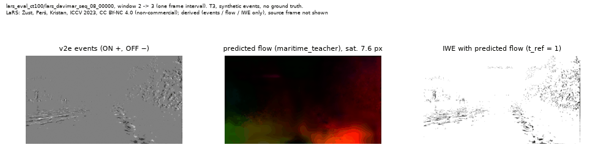
  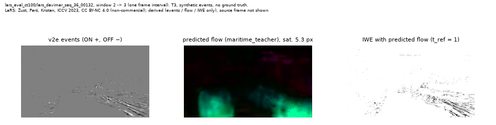
</p>
<sub>The first two <code>lars_eval</code> corpus clips (fixed in Phase 7 before any prediction was
viewed): v2e events, flow predicted by <code>maritime_teacher</code>, and the image of events
warped by that flow (sharper = more self-consistent). The LaRS source frame is <b>not</b> shown
(D-065). Derived from LaRS (Žust, Perš, Kristan, ICCV 2023), CC BY-NC 4.0, non-commercial. No SMD
imagery appears anywhere (no licence stated).</sub>

### Sea-clutter event budget (T3b, synthetic)

<p align="center">
  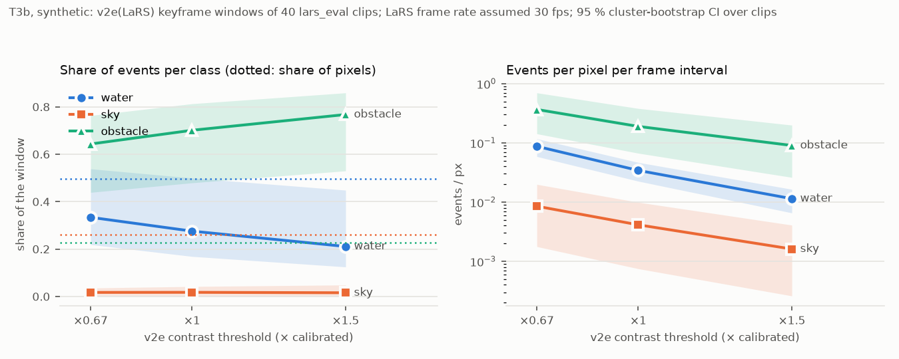
</p>

<sub>T3b. Results computed on v2e events from LaRS (Žust et al., ICCV 2023, CC BY-NC 4.0);
aggregate metrics only, no imagery.</sub>

<details open>
<summary><b>Table H — sea-clutter event budget (T3b)</b></summary>

<!-- BEGIN generated:table-h-clutter -->
Keyframe windows of the 40 `lars_eval` clips converted at three contrast-threshold multipliers on the calibrated profile (D-054, D-058); each event takes the LaRS class of its pixel. Event share = class events / all events; pixel share = class px / all px; enrichment = event share / pixel share; events per px per frame interval (LaRS frame rate assumed, D-024). Pooled over clips (event-weighted), [95 % CI] = cluster bootstrap over clips. Synthetic: these describe v2e on LaRS frames, not a real sensor.

| tier | CT | class | event share | pixel share | enrichment | events / px / frame interval |
|---|---|---|---|---|---|---|
| T3b | ×0.67 | water | 0.334 [0.219, 0.538] | 0.496 [0.462, 0.532] | 0.673 [0.445, 1.064] | 0.087 [0.059, 0.117] |
| T3b | ×0.67 | sky | 0.017 [0.004, 0.036] | 0.261 [0.204, 0.323] | 0.066 [0.015, 0.128] | 0.009 [0.002, 0.020] |
| T3b | ×0.67 | obstacle | 0.643 [0.439, 0.763] | 0.228 [0.180, 0.276] | 2.819 [1.903, 3.701] | 0.366 [0.142, 0.697] |
| T3b | ×1 | water | 0.276 [0.169, 0.500] | 0.496 [0.462, 0.532] | 0.555 [0.341, 0.993] | 0.034 [0.022, 0.047] |
| T3b | ×1 | sky | 0.018 [0.003, 0.042] | 0.261 [0.204, 0.323] | 0.067 [0.012, 0.149] | 0.004 [0.001, 0.010] |
| T3b | ×1 | obstacle | 0.701 [0.479, 0.813] | 0.228 [0.180, 0.276] | 3.073 [2.061, 4.014] | 0.189 [0.067, 0.380] |
| T3b | ×1.5 | water | 0.211 [0.125, 0.448] | 0.496 [0.462, 0.532] | 0.425 [0.255, 0.889] | 0.011 [0.007, 0.016] |
| T3b | ×1.5 | sky | 0.016 [0.002, 0.049] | 0.261 [0.204, 0.323] | 0.060 [0.009, 0.171] | 0.002 [0.000, 0.004] |
| T3b | ×1.5 | obstacle | 0.768 [0.530, 0.859] | 0.228 [0.180, 0.276] | 3.364 [2.258, 4.302] | 0.090 [0.026, 0.199] |
<!-- END generated:table-h-clutter -->

</details>

### Agreement with the RAFT teacher (T3a) and self-consistency (T3b)

<p align="center">
  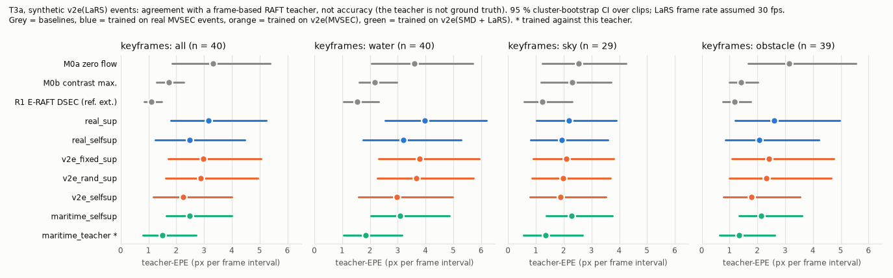
</p>
<sub>T3a. Results computed on v2e events from LaRS (Žust et al., ICCV 2023, CC BY-NC 4.0); models
trained on MVSEC, or on v2e events from SMD (Prasad et al., T-ITS 2017) and LaRS; aggregate
metrics only, no imagery.</sub>

<details>
<summary><b>Protocol and Tables F-T3a / G-T3b</b></summary>

<!-- BEGIN generated:t3-protocol -->
**Evidence tiers.** T3a = v2e events simulated from maritime video (SMD on-board, LaRS), scored against a frame-based RAFT teacher on the source frames ("teacher-EPE": agreement with the teacher, not accuracy; the teacher is not ground truth). T3b = the same events, self-consistency only (FWL, RSAT; not accuracy). No T1/T2 row appears in this part, and no T3 row appears above it. v2e events inherit the source video's dynamic range, blur and frame rate, so nothing here measures glare or dynamic-range behaviour of a real event sensor (plan §0(1)).

**Protocol (D-054, D-057).** 640×360 v2e output grid (LaRS sources of other aspect ratios are stretched); windows of one source-frame interval, flow in px per frame interval; SMD at 30 fps (ffprobe), **LaRS at an assumed 30 fps (D-024)** — px per frame interval does not depend on it; the first windows of each v2e unit are dropped (warm-up, count in the summary's `protocol`). LaRS kf = the window ending at each keyframe of the `lars_eval` corpus clips, sliced by the keyframe's LaRS label (water / sky / obstacle; all = full frame). Teacher mask = forward-backward-consistent ∧ pixel has events ∧ slice (D-055). mean [95 % CI]: SMD pooled = mean of the three video means, stratified moving-block bootstrap (1 s blocks); LaRS = cluster bootstrap over clips; 1000 resamples, seed 0. 3-seed arms: per-window seed mean, `r` = range of the per-seed means. M1 arms other than the maritime ones were trained on MVSEC driving (346×260) and are applied zero-shot. R1 = E-RAFT DSEC checkpoint, `reference_external` (trained on 100 ms DSEC volumes).
<!-- END generated:t3-protocol -->

**Table F-T3a — teacher-EPE**

<!-- BEGIN generated:table-f-t3a -->
**teacher-EPE (px per frame interval)**

| tier | arm | model | seeds | SMD test (3 videos) | LaRS kf: all | kf: water | kf: sky | kf: obstacle | LaRS all windows |
|---|---|---|---|---|---|---|---|---|---|
| T3a | zero_flow | M0a | – | 14.720 [13.387, 16.333] | 3.310 [1.842, 5.384] | 3.605 [2.057, 5.704] | 2.535 [1.229, 4.237] | 3.132 [1.670, 5.551] | 3.071 [1.927, 4.517] |
| T3a | cm_baseline | M0b | – | 4.914 [3.853, 6.785] | 1.723 [1.282, 2.276] | 2.180 [1.610, 2.955] | 2.295 [1.180, 3.716] | 1.422 [0.985, 2.016] | 1.942 [1.563, 2.348] |
| T3a | eraft_dsec `reference_external` | R1 | – | 13.306 [11.993, 14.924] | 1.108 [0.833, 1.487] | 1.550 [1.052, 2.302] | 1.224 [0.579, 2.310] | 1.175 [0.760, 1.772] | 1.259 [0.895, 1.791] |
| T3a | real_sup | M1 | 1337/2026/7 | 13.834 [12.495, 15.477] r [13.083, 14.849] | 3.149 [1.804, 5.239] r [3.099, 3.184] | 3.980 [2.536, 6.185] r [3.876, 4.095] | 2.199 [1.017, 3.889] r [2.151, 2.266] | 2.613 [1.209, 4.973] r [2.576, 2.670] | 2.878 [1.823, 4.282] r [2.830, 2.902] |
| T3a | v2e_fixed_sup | M1 | 1337/2026/7 | 14.973 [13.557, 16.775] r [14.919, 15.081] | 2.978 [1.704, 5.056] r [2.928, 3.027] | 3.776 [2.320, 5.943] r [3.708, 3.814] | 2.093 [0.908, 3.807] r [2.066, 2.111] | 2.414 [1.073, 4.748] r [2.381, 2.433] | 2.712 [1.720, 4.112] r [2.663, 2.760] |
| T3a | v2e_rand_sup | M1 | 1337/2026/7 | 15.275 [13.856, 17.077] r [14.958, 15.637] | 2.881 [1.612, 4.929] r [2.819, 2.927] | 3.668 [2.265, 5.732] r [3.515, 3.812] | 1.988 [0.857, 3.689] r [1.975, 1.997] | 2.321 [0.983, 4.654] r [2.313, 2.336] | 2.592 [1.634, 3.984] r [2.528, 2.660] |
| T3a | real_selfsup | M1 | 1337 | 14.513 [13.182, 16.146] | 2.471 [1.251, 4.456] | 3.195 [1.746, 5.289] | 1.922 [0.811, 3.599] | 2.065 [0.851, 4.209] | 2.216 [1.330, 3.500] |
| T3a | v2e_selfsup | M1 | 1337 | 14.488 [13.156, 16.182] | 2.236 [1.177, 4.005] | 2.963 [1.594, 4.973] | 1.879 [0.792, 3.513] | 1.794 [0.773, 3.545] | 2.059 [1.251, 3.222] |
| T3a | maritime_selfsup | M1 | 1337 | 11.827 [10.620, 13.444] | 2.481 [1.629, 4.005] | 3.075 [2.030, 4.859] | 2.277 [1.364, 3.749] | 2.147 [1.334, 3.619] | 2.282 [1.677, 3.289] |
| T3a | maritime_teacher | M1 | 1337 | 10.790 [9.425, 12.647] | 1.505 [0.792, 2.722] | 1.843 [1.037, 3.142] | 1.339 [0.548, 2.681] | 1.337 [0.634, 2.624] | 1.367 [0.859, 2.148] |
| T3a | n windows | – | – | 822 | 40 | 40 | 29 | 39 | 475 |
<!-- END generated:table-f-t3a -->

**Table G-T3b — FWL**

<!-- BEGIN generated:table-g-t3b -->
`maritime_selfsup` (and M0b) optimise a contrast-maximisation objective on these very statistics, so leading on FWL/RSAT is partly built in; FWL/RSAT are self-consistency, not accuracy (D-062). Read them beside Table F.

**FWL (> 1 better)**

| tier | arm | model | seeds | SMD test (3 videos) | LaRS kf: all | kf: water | kf: sky | kf: obstacle | LaRS all windows |
|---|---|---|---|---|---|---|---|---|---|
| T3b | zero_flow | M0a | – | 1.000 [1.000, 1.000] | 1.000 [1.000, 1.000] | 1.000 [1.000, 1.000] | 1.000 [1.000, 1.000] | 1.000 [1.000, 1.000] | 1.000 [1.000, 1.000] |
| T3b | cm_baseline | M0b | – | 1.548 [1.403, 1.696] | 1.508 [1.363, 1.669] | 1.355 [1.268, 1.448] | 1.209 [1.082, 1.360] | 1.460 [1.308, 1.639] | 1.507 [1.372, 1.656] |
| T3b | eraft_dsec `reference_external` | R1 | – | 1.157 [1.074, 1.271] | 1.382 [1.251, 1.531] | 1.218 [1.148, 1.297] | 1.198 [1.096, 1.327] | 1.393 [1.262, 1.544] | 1.361 [1.245, 1.495] |
| T3b | real_sup | M1 | 1337/2026/7 | 1.046 [1.032, 1.054] r [1.038, 1.051] | 1.144 [1.090, 1.204] r [1.143, 1.145] | 1.126 [1.077, 1.177] r [1.121, 1.130] | 1.033 [1.008, 1.073] r [1.027, 1.039] | 1.113 [1.059, 1.171] r [1.108, 1.115] | 1.152 [1.100, 1.211] r [1.149, 1.155] |
| T3b | v2e_fixed_sup | M1 | 1337/2026/7 | 1.036 [1.024, 1.043] r [1.035, 1.037] | 1.168 [1.105, 1.236] r [1.162, 1.173] | 1.125 [1.082, 1.166] r [1.119, 1.128] | 1.043 [1.010, 1.091] r [1.038, 1.048] | 1.157 [1.090, 1.228] r [1.153, 1.162] | 1.175 [1.116, 1.242] r [1.173, 1.179] |
| T3b | v2e_rand_sup | M1 | 1337/2026/7 | 1.033 [1.021, 1.041] r [1.031, 1.039] | 1.195 [1.119, 1.281] r [1.190, 1.201] | 1.138 [1.094, 1.182] r [1.132, 1.150] | 1.055 [1.013, 1.118] r [1.052, 1.057] | 1.189 [1.109, 1.276] r [1.182, 1.193] | 1.201 [1.130, 1.285] r [1.197, 1.208] |
| T3b | real_selfsup | M1 | 1337 | 1.011 [1.003, 1.022] | 1.244 [1.149, 1.352] | 1.094 [1.047, 1.146] | 1.107 [1.047, 1.189] | 1.294 [1.191, 1.413] | 1.243 [1.154, 1.347] |
| T3b | v2e_selfsup | M1 | 1337 | 1.027 [1.009, 1.046] | 1.305 [1.219, 1.399] | 1.171 [1.113, 1.232] | 1.105 [1.053, 1.174] | 1.312 [1.222, 1.418] | 1.300 [1.220, 1.394] |
| T3b | maritime_selfsup | M1 | 1337 | 1.301 [1.200, 1.415] | 1.446 [1.362, 1.538] | 1.383 [1.315, 1.458] | 1.213 [1.146, 1.298] | 1.400 [1.308, 1.501] | 1.448 [1.369, 1.534] |
| T3b | maritime_teacher | M1 | 1337 | 1.225 [1.141, 1.321] | 1.322 [1.234, 1.422] | 1.233 [1.172, 1.299] | 1.171 [1.093, 1.268] | 1.304 [1.210, 1.408] | 1.320 [1.238, 1.415] |
| T3b | n windows | – | – | 844 | 40 | 40 | 29 | 39 | 475 |
<!-- END generated:table-g-t3b -->

RSAT, the teacher-3PE family and the scene-attribute breakdown of the clutter study are in
[results/TABLES.md](results/TABLES.md).

</details>

## Deployment: ONNX parity and timing

The primary checkpoint (`real_sup`, lowest `mvsec_tune` EPE, D-063) is exported to ONNX; the
event-representation build stays outside the graph and is timed separately. **Deployment claims
are fp32 only**: the fp16 graphs miss the plan's parity tolerance, which was not loosened (D-064).
**The RTX A4000 used here stands in for an embedded target; latency on an embedded GPU will
differ.** These are timings of the network on a GPU, not event-sensor latency.

<p align="center">
  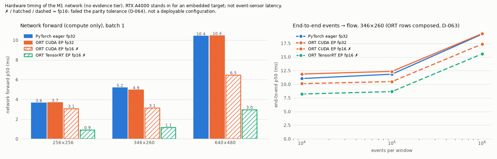
</p>

<details open>
<summary><b>Table I-T1 — ONNX parity (T1)</b></summary>

<!-- BEGIN generated:table-i-parity -->
200 fixed windows (50 per sequence, evenly spaced (np.unique(np.linspace(0, n - 1, k).round())) over each mvsec_test dt1 unit; fixed in configs/evflow.yaml export.parity before any ONNX output). Same input to both sides (representation built outside the graph); reference = torch fp32 eager on CUDA, TF32 off. max |Δflow| = largest vector difference over every pixel of every window (the gated number); masked = over the evaluation mask. EPE change = |EPE(ONNX) − EPE(torch)| of the window mean. Tolerances: fp32 ≤ 0.001 px, fp16 ≤ 0.05 px, EPE change ≤ 0.01 px.

| tier | arm | seed | provider | graph | max |Δflow| (px) | masked max (px) | EPE change (px) | tol. max (px) | verdict |
|---|---|---|---|---|---|---|---|---|---|
| T1 | real_sup | 1337 | ort_cuda_fp32 | fp32 | 7.32e-05 | 5.93e-05 | 3.69e-07 | 0.001 | PASS |
| T1 | real_sup | 1337 | ort_cuda_fp16 | fp16 | 9.34e-02 | 9.24e-02 | 5.23e-04 | 0.05 | FAIL |
| T1 | real_sup | 1337 | ort_trt_fp16 | fp32 | 9.57e-02 | 9.09e-02 | 8.72e-07 | 0.05 | FAIL |
| T1 | real_sup | 1337 | torch_cuda_fp16 (diagnostic) | fp16 | 5.59e-02 | 4.47e-02 | 3.91e-04 | — | not gated |
| T1 | v2e_rand_sup | 7 | ort_cuda_fp32 | fp32 | 5.42e-05 | 4.71e-05 | 1.82e-07 | 0.001 | PASS |
| T1 | v2e_rand_sup | 7 | ort_cuda_fp16 | fp16 | 2.36e-01 | 1.96e-01 | 6.09e-04 | 0.05 | FAIL |
| T1 | v2e_rand_sup | 7 | ort_trt_fp16 | fp32 | 4.91e-01 | 4.28e-01 | 1.10e-03 | 0.05 | FAIL |
| T1 | v2e_rand_sup | 7 | torch_cuda_fp16 (diagnostic) | fp16 | 1.45e-01 | 1.12e-01 | 2.00e-04 | — | not gated |

All rows pass: **no**.

**Non-conforming (D-064):** ort_cuda_fp16, ort_trt_fp16 fail the unchanged tolerance and carry no deployment claim; deployment claims are fp32 only. Gate (every other row passes): **yes**.
<!-- END generated:table-i-parity -->

</details>

<details>
<summary><b>Table J — latency (hardware timing, no tier)</b></summary>

<!-- BEGIN generated:table-j-latency -->
RTX A4000 (desktop, WSL2) stands in for an embedded target; embedded latency will differ. Nothing here measures or implies event-camera sensor latency or a latency advantage of event cameras (CLAUDE.md rule 2). Hardware timing of the M1 network and its input build; not a flow metric, so no evidence tier applies. Inputs are synthetic (seeded).

**Accuracy.** Backends that failed parity (results/onnx_parity.json, Table I-T1): ort_cuda_fp16, ort_trt_fp16; their timings are not a claim of a deployable configuration at the plan's tolerance.

GPU NVIDIA RTX A4000; batch 1; 50 warm-up, 500 timed iterations per cell; ms, p50 / p90 / p99 / max. Versions and GPU state: `results/latency.json` `environment`.

#### J1 — representation build (torch-CUDA, events on the GPU)

| events / window | frame | p50 | p90 | p99 | max | events H2D p50 |
|---|---|---|---|---|---|---|
| 10000 | 346×260 | 4.924 | 5.853 | 7.767 | 9.003 | 0.341 |
| 100000 | 346×260 | 5.030 | 6.302 | 8.546 | 10.911 | 0.974 |
| 1000000 | 346×260 | 7.133 | 8.155 | 9.525 | 10.334 | 5.751 |
| 10000 | 640×480 | 5.063 | 6.313 | 8.266 | 14.328 | 0.324 |
| 100000 | 640×480 | 5.345 | 6.336 | 7.777 | 10.789 | 0.980 |
| 1000000 | 640×480 | 7.531 | 8.696 | 11.129 | 17.931 | 5.811 |

#### J2 — network forward (compute only; ORT H2D / D2H separate)

| input (padded) | backend | p50 | p90 | p99 | max | H2D / D2H p50 | TRT cold build (s) | nodes per EP |
|---|---|---|---|---|---|---|---|---|
| 256×256 (256×256) | pytorch_eager_fp32 | 3.638 | 4.833 | 5.902 | 7.342 | — | — | — |
| 346×260 (352×272) | pytorch_eager_fp32 | 5.177 | 5.672 | 6.900 | 9.182 | — | — | — |
| 640×480 (640×480) | pytorch_eager_fp32 | 10.397 | 10.728 | 11.725 | 17.186 | — | — | — |
| 256×256 (256×256) | ort_cuda_fp32 | 3.658 | 3.966 | 5.200 | 6.187 | 0.332 / 0.169 | — | CUDA 41 |
| 256×256 (256×256) | ort_cuda_fp16 | 3.059 | 3.400 | 4.752 | 6.909 | 0.223 / 0.124 | — | CUDA 41 |
| 256×256 (256×256) | ort_trt_fp16 | 0.901 | 1.099 | 2.938 | 3.392 | 0.316 / 0.163 | 26.7 | Tensorrt 1 |
| 346×260 (352×272) | ort_cuda_fp32 | 4.937 | 5.192 | 6.287 | 8.013 | 0.419 / 0.231 | — | CUDA 41 |
| 346×260 (352×272) | ort_cuda_fp16 | 3.135 | 3.925 | 5.821 | 6.617 | 0.286 / 0.152 | — | CUDA 41 |
| 346×260 (352×272) | ort_trt_fp16 | 1.148 | 1.570 | 2.168 | 2.988 | 0.395 / 0.231 | 24.4 | Tensorrt 1 |
| 640×480 (640×480) | ort_cuda_fp32 | 10.438 | 10.901 | 11.640 | 13.274 | 1.101 / 0.476 | — | CUDA 41 |
| 640×480 (640×480) | ort_cuda_fp16 | 6.450 | 7.252 | 9.762 | 12.391 | 0.596 / 0.299 | — | CUDA 41 |
| 640×480 (640×480) | ort_trt_fp16 | 2.951 | 3.060 | 3.608 | 4.226 | 0.939 / 0.460 | 34.1 | Tensorrt 1 |

#### J3 — end-to-end (events → flow on the host)

PyTorch rows are measured in one bracket; ORT rows are composed from stages timed in two processes (sum of i-th samples, tails assume independent stages; D-063) and include a voxel D2H + H2D round trip a single-process deployment would not pay; ort_cuda_fp16 rows omit the fp32 → fp16 cast. Σ stage max bounds the observed stage samples only.

| events / window | frame | backend | how | p50 | p90 | p99 | max | Σ stage max |
|---|---|---|---|---|---|---|---|---|
| 10000 | 346×260 | pytorch_eager_fp32 | measured | 11.040 | 13.431 | 16.048 | 19.399 | — |
| 100000 | 346×260 | pytorch_eager_fp32 | measured | 11.842 | 14.465 | 18.479 | 21.077 | — |
| 1000000 | 346×260 | pytorch_eager_fp32 | measured | 19.163 | 20.314 | 21.699 | 23.036 | — |
| 10000 | 346×260 | ort_cuda_fp32 | composed | 11.869 | 14.747 | 18.149 | 21.617 | 30.706 |
| 10000 | 346×260 | ort_cuda_fp16 | composed | 10.112 | 13.055 | 16.621 | 19.230 | 26.004 |
| 10000 | 346×260 | ort_trt_fp16 | composed | 8.208 | 10.990 | 14.334 | 17.717 | 24.235 |
| 100000 | 346×260 | ort_cuda_fp32 | composed | 12.352 | 14.120 | 16.686 | 17.863 | 25.784 |
| 100000 | 346×260 | ort_cuda_fp16 | composed | 10.485 | 12.438 | 14.980 | 17.419 | 21.082 |
| 100000 | 346×260 | ort_trt_fp16 | composed | 8.653 | 10.365 | 13.083 | 16.033 | 19.313 |
| 1000000 | 346×260 | ort_cuda_fp32 | composed | 19.261 | 20.577 | 23.630 | 27.684 | 40.740 |
| 1000000 | 346×260 | ort_cuda_fp16 | composed | 17.351 | 18.907 | 21.780 | 25.423 | 36.038 |
| 1000000 | 346×260 | ort_trt_fp16 | composed | 15.553 | 16.813 | 19.884 | 23.628 | 34.269 |
<!-- END generated:table-j-latency -->

</details>

## Reproduce

```bash
uv venv -p 3.11 .venv && source .venv/bin/activate   # full set-up: REPO_SETUP.md
uv pip install -r requirements.lock && uv pip install -e . --no-deps
make lint test                 # CPU, no data
make reproduce-tables          # check results/TABLES.md + README blocks against committed JSON
python scripts/make_tables.py  # re-render them
python scripts/make_figures.py --bars-only   # JSON-only figures
```

With data (`scripts/fetch_data.py` → gitignored `data/`; paths in `configs/paths.local.yaml`):
v2e runs in its own venv `external/venvs/v2e/` via `src/evflow/sim/v2e_runner.py`; every GPU job
is a script plus manifest under `jobs/` (listed in `docs/STATUS.md`); ONNX Runtime runs in
`external/venvs/ort/`. Splits are fixed with SHA-256 manifests in `splits/`; calibration, CT range
and every epoch/model selection use `mvsec_tune` only, test sequences are evaluation-only.
Judgement calls are in [docs/DECISIONS.md](docs/DECISIONS.md), phase gates in
[docs/gates/](docs/gates/).

<details>
<summary><b>MVSEC evaluation protocol</b> (quoted from <code>configs/eval_mvsec.yaml</code>)</summary>

<!-- BEGIN generated:eval-protocol -->
```yaml
# MVSEC evaluation protocol. Fixed in Phase 1 (D-019), quoted verbatim in the README.
# Sources: EV-FlowNet eval code (daniilidis-group/EV-FlowNet @cf801ef src/test.py, src/eval_utils.py)
# and E-RAFT (uzh-rpg/E-RAFT @c58ce05 config/mvsec_20.json). No code from either is copied.
camera: left
pixel_space: raw_distorted        # *_gt_flow_dist.npz and davis/left/events share it (D-015, A5)
gt_source: "*_gt_flow_dist.npz (keys: timestamps, x_flow_dist, y_flow_dist; 20 Hz, Unix s)"

regions:
  center_256: {rows: [2, 258], cols: [45, 301]}          # EV-FlowNet central 256x256 crop
  center_256_no_hood: {rows: [2, 192], cols: [45, 301]}  # + car hood: full-image rows >= 192

sequences:
  indoor_flying1: {windows: {rule: all_in_gt_span}, region: center_256}
  indoor_flying2: {windows: {rule: all_in_gt_span}, region: center_256}
  indoor_flying3: {windows: {rule: all_in_gt_span}, region: center_256}
  outdoor_day1:
    windows:
      rule: time_range
      # Span of GT fields 4356-4705 of outdoor_day1_gt_flow_dist.npz, i.e. gt.timestamps[4356] ..
      # gt.timestamps[4706] (222.97-240.47 s after the first event). The field indices are the
      # ones in E-RAFT config/mvsec_20.json; the APS windows over this span are our construction
      # (E-RAFT pairs the same fields with different event windows, see reproduction_eraft).
      t_start_s: 1506118120.162041
      t_end_s: 1506118137.667426
      expected_n_windows: {dt1: 797, dt4: 794}   # APS frames 10164-10960 (dt1), 10164-10957 (dt4)
    region: center_256_no_hood

dt_frames: [1, 4]                 # window = [aps_ts[k], aps_ts[k+dt]]; never averaged across dt
window_stride_frames: 1           # every APS frame k starts a window, for both dt
# rule all_in_gt_span: aps_ts[k] >= gt.timestamps[0] and aps_ts[k+dt] <= gt.timestamps[-1]
# rule time_range:     aps_ts[k] >= t_start_s and aps_ts[k+dt] <= t_end_s

mask:
  valid_gt: finite_and_nonzero    # GT finite and |GT| > 0 (after propagation), EV-FlowNet rule
  sparse_events_in_window: true   # pixel has >= 1 event (either polarity) in the window
  dense_variant_also_reported: false
averaging: per_window_mean_then_mean_over_windows   # windows with 0 valid px skipped and counted

gt_interpolation: >-
  EV-FlowNet propagation (io/mvsec.py: gt_flow_for_window). Each GT field i is the px displacement
  from timestamps[i] to timestamps[i+1]. If the window is shorter than the GT interval containing
  its start, GT = field * dt / gt_dt. Otherwise pixel positions are advanced through successive
  fields (nearest-pixel lookup, cv2.remap INTER_NEAREST, border 0), the partial first and last
  intervals scaled linearly; a pixel whose looked-up flow is exactly 0 (incl. leaving the image)
  is invalid. Never x4 of dt=1.
```
<!-- END generated:eval-protocol -->

</details>

## Limitations

The full list, with one verdict per validation-checklist line, is in
[docs/LIMITATIONS.md](docs/LIMITATIONS.md). The ones that most change how to read the results:

- **Indoor zero-flow floor.** On the indoor MVSEC sequences at dt = 1 the supervised arms are at
  or near zero-flow EPE (D-046), so gaps there compare models near that floor; read the
  outdoor_day1 column for the simulator gap.
- **Seeds.** Supervised arms have three seeds, self-supervised arms one. CIs resample windows
  only; between-seed spread is reported separately and is often larger (D-053).
- **The calibrated v2e profile does not reproduce the test recordings' event statistics**
  (D-033), and correct event timing required turning v2e's photoreceptor lowpass off (D-035).
- **Reduced corpus.** Training uses a subset of `outdoor_day2`; maritime corpora are subsets
  (D-026, D-054).
- **Maritime numbers are T3 only**, LaRS frame rate is assumed, and LaRS sources of other aspect
  ratios are stretched to the v2e grid (D-024, D-054).
- **fp16 deployment is non-conforming** (D-064); the timing GPU is a desktop stand-in.

## Positioning

Synthetic-event optical-flow datasets exist for underwater scenes (eStonefish-Scenes, 2025; UEOF,
WACVW 2026), and the effect of the simulated contrast threshold on sim-to-real transfer of event
networks is established (Stoffregen et al., ECCV 2020). A literature search on the day this
project was planned found no above-water maritime event-flow dataset or study. What this
repository contributes: (i) a matched-supervision measurement of v2e's sim-to-real gap for event
optical flow on MVSEC, with calibration vs randomisation of the contrast threshold; (ii) an
above-water maritime v2e pipeline with class-sliced T3 evaluation and a sea-clutter event-budget
study; (iii) deployment measurements of the representation build and network on one GPU. It does
not claim novelty for training optical flow on synthetic events.

## Release assets

Checkpoints of the main MVSEC arms, fp32 ONNX graphs and `SHA256SUMS.txt` are attached to the
GitHub release; the list, hashes and licence are in [docs/RELEASE.md](docs/RELEASE.md). **No event
data, frames or ground truth** are in the repository or the release, and no model trained on
maritime data is released.

## Licences and attribution

- **Code** (`src/`, `tests/`, `scripts/`): MIT ([LICENSE](LICENSE)). Vendored third-party code
  keeps its header: E-RAFT model (MIT) and RAFT (BSD-3-Clause) in `src/evflow/models/eraft_ref/`,
  tudelft/event_flow metric oracle (MIT) in `tests/oracles/`. No GPL code is copied or imported.
- **Released weights**: [CC BY-SA 4.0](https://creativecommons.org/licenses/by-sa/4.0/)
  (trained on MVSEC), see [docs/RELEASE.md](docs/RELEASE.md).
- **README media in `results/figures/readme/` are not MIT**: each file's licence and attribution
  is listed in [results/figures/readme/LICENSE.md](results/figures/readme/LICENSE.md).
- **MVSEC and DSEC** derived figures and animations:
  [CC BY-SA 4.0](https://creativecommons.org/licenses/by-sa/4.0/), attributed in each caption;
  shared under the same licence.
- **LaRS** derived animations (events, flow and warped events only, no source frames):
  [CC BY-NC 4.0](https://creativecommons.org/licenses/by-nc/4.0/), non-commercial; obtain LaRS
  itself from its
  [dataset page](https://lojzezust.github.io/lars-dataset/).
- **SMD**: used for research only; no imagery shown, nothing redistributed.
- Per-item terms and the dates they were checked: [docs/LICENSES.md](docs/LICENSES.md).

## Citations

Please cite the datasets and tools this work builds on:

- **MVSEC** — A. Z. Zhu, D. Thakur, T. Özaslan, B. Pfrommer, V. Kumar, K. Daniilidis, "The
  Multi Vehicle Stereo Event Camera Dataset: An Event Camera Dataset for 3D Perception," IEEE
  RA-L 3(3):2032–2039, 2018.
- **MVSEC ground-truth flow / EV-FlowNet** — A. Z. Zhu, L. Yuan, K. Chaney, K. Daniilidis,
  "EV-FlowNet: Self-Supervised Optical Flow Estimation for Event-based Cameras," RSS 2018.
- **DSEC** — M. Gehrig, W. Aarents, D. Gehrig, D. Scaramuzza, "DSEC: A Stereo Event Camera Dataset
  for Driving Scenarios," IEEE RA-L 2021.
- **E-RAFT / DSEC-Flow** — M. Gehrig, M. Millhäusler, D. Gehrig, D. Scaramuzza, "E-RAFT: Dense
  Optical Flow from Event Cameras," 3DV 2021.
- **RAFT** — Z. Teed, J. Deng, "RAFT: Recurrent All-Pairs Field Transforms for Optical Flow," ECCV
  2020.
- **v2e** — Y. Hu, S.-C. Liu, T. Delbruck, "v2e: From Video Frames to Realistic DVS Events," CVPRW
  2021. Interpolation: H. Jiang et al., "Super SloMo," CVPR 2018.
- **LaRS** — L. Žust, J. Perš, M. Kristan, "LaRS: A Diverse Panoptic Maritime Obstacle Detection
  Dataset and Benchmark," ICCV 2023.
- **SMD** — D. K. Prasad, D. Rajan, L. Rachmawati, E. Rajabally, C. Quek, "Video Processing from
  Electro-optical Sensors for Object Detection and Tracking in Maritime Environment: A Survey,"
  IEEE T-ITS 18(8):1993–2016, 2017. "Dataset has been captured by Dilip K. Prasad and annotated
  by student volunteers."
- **Sim-to-real for event cameras, FWL** — T. Stoffregen, C. Scheerlinck, D. Scaramuzza, T.
  Drummond, N. Barnes, L. Kleeman, R. Mahony, "Reducing the Sim-to-Real Gap for Event Cameras,"
  ECCV 2020.
- **Related synthetic underwater event-flow datasets** — eStonefish-Scenes, arXiv:2505.13309
  (2025); UEOF, arXiv:2601.10054 (WACVW 2026).
- **tudelft/event_flow (FWL / RSAT reference implementation)** — J. Hagenaars, F. Paredes-Vallés,
  G. de Croon, "Self-Supervised Learning of Event-Based Optical Flow with Spiking Neural
  Networks," NeurIPS 2021.
